<div align="center">

```python
llm.invoke("Generate a bio")
```
</div>

<div align="center">
<h1>PRANAV MISHRA</h1>

<p align="center">
  
</p>

[](https://pranavmishra17.vercel.app)
[](https://www.linkedin.com/in/pranavgamedev/)
[](https://pranavmishra17.vercel.app/resume)
[](https://www.youtube.com/@parano1dgames/featured)
[](https://huggingface.co/Paranoiid)
[](https://scholar.google.com/citations?hl=en&user=_Twn_owAAAAJ)
[](https://letterboxd.com/paranoid_critic/)

</div>

<div align="center">
<p>
  <em>"In order to keep up with everything AI, you need to be unemployed.<br/>
  In order to keep paying for the tokens, you need to be employed."</em>
</p>


</div>

---

## 🧠 Now: Founding Engineer at alfred_

<table>
<tr>
<td width="56%" valign="top">

**Then:** I joined as a founding engineer and built the **eval harness** and the **production scanner**: a number for every version of the agent, and an eye on what it does with real users.

**Now:** **Working memory**: your whole workday on one screen, kept current across email, calendar, meeting notes, Slack and Teams. The hard part is the data: sources that overlap, contradict each other and change by the minute, reconciled into one view you can trust.

**Also:** making alfred_ the layer that **orchestrates and delegates**: routine workers, MCP apps, long-running tasks and workflows.

</td>
<td width="44%" align="center" valign="top">
  <a href="https://get-alfred.ai/">
    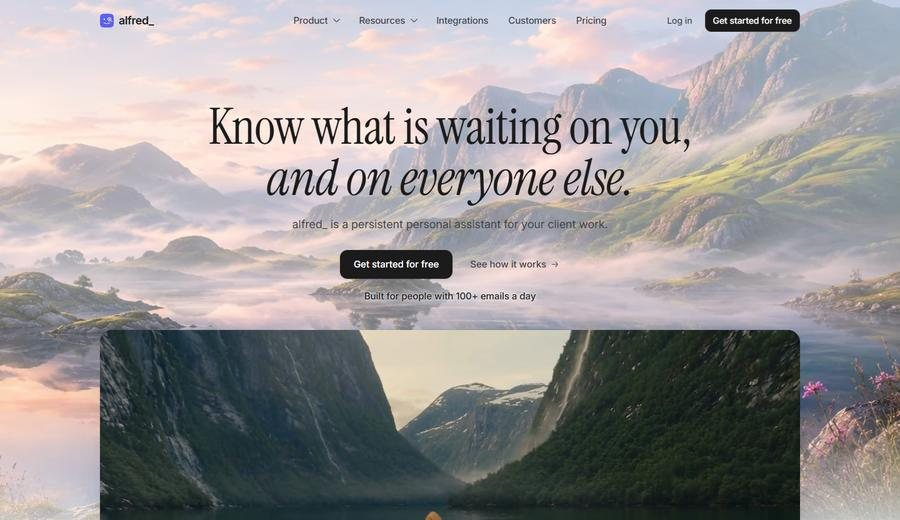
  </a>
  <br/>
  <sub>5,000+ people &nbsp;·&nbsp; text, chat, voice &nbsp;·&nbsp; also inside Claude Code and Codex</sub>
  <br/>
  <a href="https://get-alfred.ai/"><b>Try alfred_ ↗</b></a>
</td>
</tr>
</table>

| | before | after | what shipped |
|---|---|---|---|
| ⚡ | polling | **~3 s** | Every user moved onto event-driven email ingress, live, in one week. Email-to-text went from ~90 s to ~3 s. |
| 🧩 | LLM recall | **working memory** | Code assembles the real candidates, the model only picks and writes; fabricated threads are structurally impossible. |
| 🔌 | 721 ms | **30× faster** | alfred_ as a public MCP server behind an OAuth server I built, usable from Claude Code, Codex or any MCP client. |
| 🧪 | read it back | **replayed** | Every agent turn replayable against fixtures and scored before it ships. |
| 🎙️ | on request | **ahead of the turn** | Context assembled before the agent needs it, on SMS and voice where a pause is a failure. |

---

## 🚀 Currently Building

<table align="center">
<tr>
<td width="33%" align="center" valign="top">
  <a href="https://github.com/PranavMishra17/MockFlow-AI">
    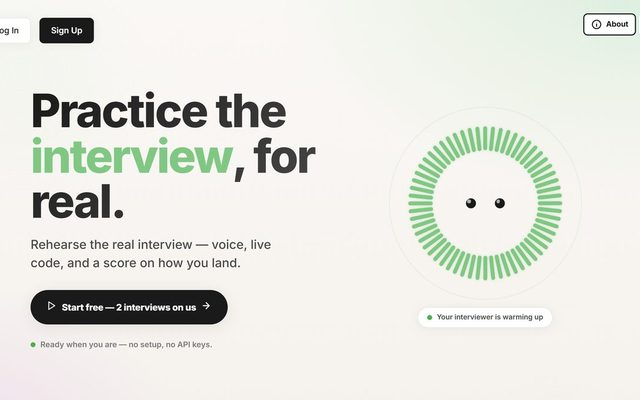
  </a>
  <br/>
  <a href="https://github.com/PranavMishra17/MockFlow-AI"><b>🎤 MockFlow-AI</b></a>
  <br/>
  <sub>A mock interviewer that talks, watches the code you type and hands back a scored report. Under 400 ms a turn.</sub>
</td>
<td width="33%" align="center" valign="top">
  <a href="https://github.com/PranavMishra17/alaap">
    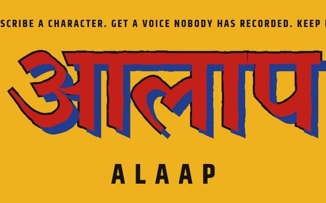
  </a>
  <br/>
  <a href="https://github.com/PranavMishra17/alaap"><b>🗣️ Alaap</b></a>
  <br/>
  <sub>Describe a character in words and get a persistent voice for it, in English, Hindi, Bengali and Tamil.</sub>
</td>
<td width="33%" align="center" valign="top">
  <a href="https://github.com/PranavMishra17/SoulEngine">
    
  </a>
  <br/>
  <a href="https://github.com/PranavMishra17/SoulEngine"><b>🎮 SoulEngine</b></a>
  <br/>
  <sub>NPCs that remember you, change over time, speak in their own voice and act on their own through MCP.</sub>
</td>
</tr>
</table>

---

## 🏆 Major Wins

🕴🏼 **[IEEE CAI 2026](https://github.com/PranavMishra17/Metadata-Enrichment-with-LLMs-for-RAGs-Internal-Knowledge-Retrieval)** (accepted, first author) - Enterprise RAG with LLM-generated metadata

📊 **INFORMS Analytics+ Conference 2025** - Took the MetaRAG project to Indianapolis

🥇 **[SnAIder-Cut](https://codeberg.org/reality-hack-2024/snAIder)** - Won a special track at MIT Reality Hack, Jan 2024, Boston. Block a film scene in mixed reality and it becomes a script

🥽 **[HoverHelp](https://github.com/PranavMishra17/HoverHelp)** - Back at MIT Reality Hack in 2026: someone on a phone sees what you see in the headset and points at things in your kitchen

🥇 **[HINT 5.0 Hackathon Winner](https://github.com/TheGreatFellow/virtual-van-gogh)** - Virtual van Gogh: a virtual art museum for NFT collections

---

## ✅ Built & Shipped

<table align="center">
<tr>
<td width="25%" align="center" valign="top"><a href="https://github.com/PranavMishra17/Big5-Agents">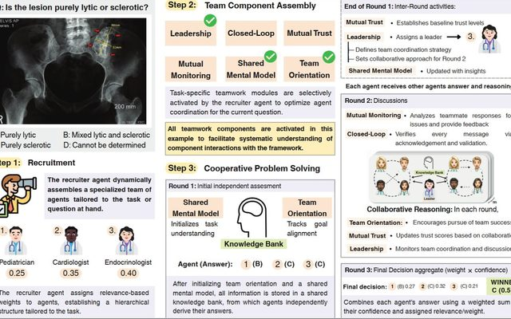</a><br/><a href="https://github.com/PranavMishra17/Big5-Agents"><b>🩺 TeamMedAgents</b></a><br/><sub>The Big Five teamwork model as switchable mechanisms between agents.</sub></td>
<td width="25%" align="center" valign="top"><a href="https://github.com/PranavMishra17/Stellarium-A-Space-Odyssey-VR-star-system">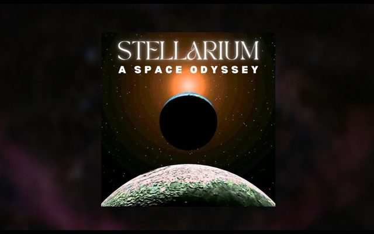</a><br/><a href="https://github.com/PranavMishra17/Stellarium-A-Space-Odyssey-VR-star-system"><b>🌌 Stellarium</b></a><br/><sub>107,000 stars on the walls of a CAVE2 room you stand inside.</sub></td>
<td width="25%" align="center" valign="top"><a href="https://github.com/PranavMishra17/SnakeAI-MLOps">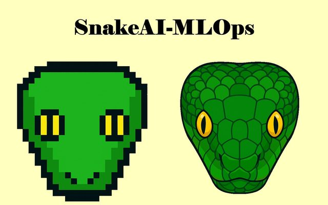</a><br/><a href="https://github.com/PranavMishra17/SnakeAI-MLOps"><b>🐍 SnakeAI-MLOps</b></a><br/><sub>Four RL agents learning one game, racing each other. <a href="https://pranavmishra17.github.io/SnakeAI-MLOps/">Play it</a>.</sub></td>
<td width="25%" align="center" valign="top"><a href="https://github.com/PranavMishra17/Auto-Prompting-for-PaintSeg">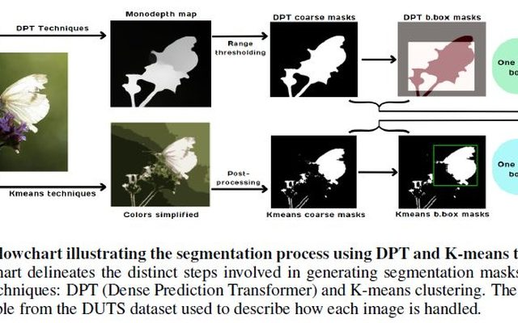</a><br/><a href="https://github.com/PranavMishra17/Auto-Prompting-for-PaintSeg"><b>🎨 Auto-PaintSeg</b></a><br/><sub>Segmentation that prompts itself, so nobody clicks the object first.</sub></td>
</tr>
<tr>
<td width="25%" align="center" valign="top"><a href="https://github.com/PranavMishra17/quorum">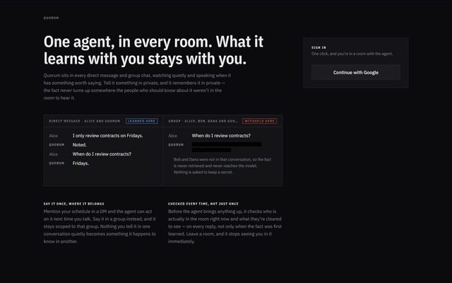</a><br/><a href="https://github.com/PranavMishra17/quorum"><b>💬 Quorum</b></a><br/><sub>One AI teammate in every room. It decides when a room needs it to speak.</sub></td>
<td width="25%" align="center" valign="top"><a href="https://github.com/PranavMishra17/Azure-Web-app-Python-for-VARE-website-UIC">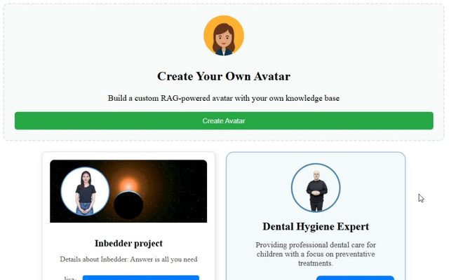</a><br/><a href="https://github.com/PranavMishra17/Azure-Web-app-Python-for-VARE-website-UIC"><b>🧑‍⚕️ AI Avatar</b></a><br/><sub>Upload documents, get a talking avatar that answers from them.</sub></td>
<td width="25%" align="center" valign="top"><a href="https://github.com/PranavMishra17/clausecraft"></a><br/><a href="https://github.com/PranavMishra17/clausecraft"><b>📝 ClauseCraft</b></a><br/><sub>Say what to change in plain words; every edit comes back with a line citation.</sub></td>
<td width="25%" align="center" valign="top"><a href="https://github.com/PranavMishra17/Nalleria"></a><br/><a href="https://github.com/PranavMishra17/Nalleria"><b>🖼️ Virtual van Gogh</b></a><br/><sub>A Unity gallery of NFTs; your entry fee goes to the artists you stood in front of.</sub></td>
</tr>
</table>

<p align="center"><sub>Also: <a href="https://github.com/PranavMishra17/VoicePersona-Dataset">Voice-Persona dataset</a> · <a href="https://github.com/PranavMishra17/Resume-Craft-Pro">Resume-Craft-Pro</a> · <a href="https://github.com/PranavMishra17/AutoCallAI">AutoCallAI</a> · <a href="https://github.com/PranavMishra17/InsightGlobal-Assesment">MedBrief</a> · and the rest on the <a href="https://pranavmishra17.vercel.app">portfolio</a>.</sub></p>

---

## Resume + Portfolio

<table align="center">
<tr>
<td width="50%" align="center">
  <a href="./RESUME%20Pranav_Mishra.pdf">
    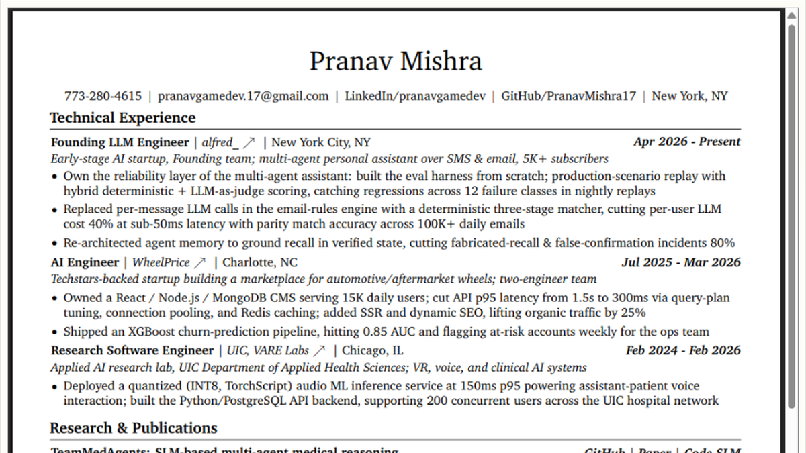
  </a>
  <br/>
  <a href="./RESUME%20Pranav_Mishra.pdf"><b>📄 Resume</b></a>
  <br/>
  <sub>View / Download my latest resume PDF</sub>
</td>
<td width="50%" align="center">
  <a href="https://pranavmishra17.vercel.app">
    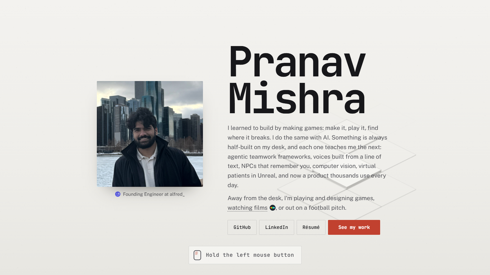
  </a>
  <br/>
  <a href="https://pranavmishra17.vercel.app"><b>🌐 Live Portfolio</b></a>
  <br/>
  <sub>Break the wall, then everything I built, the papers, and my room</sub>
</td>
</tr>
</table>

---

<div align="center">
  
  
</div>

---

## ⚡ The Arsenal
```python
class PranavMishra:
    def __init__(self):
        self.now = "Founding Engineer @ alfred_: evals, working memory, orchestration"

        # Core Languages
        self.languages = ["Python", "TypeScript/JavaScript", "C++", "C#", "Java", "Rust"]

        # AI/ML Stack
        self.ai_frameworks = ["PyTorch", "TensorFlow", "LangChain", "LangGraph", "LibTorch", "Transformers"]
        self.ai_platforms = ["Anthropic Claude", "OpenAI API", "Google Gemini", "Azure OpenAI", "Hugging Face"]
        self.agents = ["MCP servers & clients", "Multi-agent systems", "Evals & trace replay", "RAG", "Voice agents"]
        self.mlops = ["vLLM", "Docker", "GitHub Actions", "Model Versioning", "Experiment Tracking"]

        # Full-Stack & Infrastructure
        self.web_stack = {
            "frontend": ["React", "Next.js", "TypeScript", "Tailwind"],
            "backend": ["Deno", "Node.js", "FastAPI", "Flask", "Django"],
            "realtime": ["WebSockets", "WebRTC", "Azure Speech", "Cartesia TTS"]
        }
        self.databases = ["PostgreSQL (Supabase)", "pgvector", "MongoDB", "Redis", "Pinecone", "CosmosDB"]
        self.cloud_platforms = ["Azure", "AWS", "GCP", "Railway", "Vercel"]

        # Game/XR Development
        self.game_engines = ["Unity (C#)", "Unreal Engine 5 (C++)", "SFML", "WebXR"]
        self.xr = "MIT Reality Hack: won in 2024, back in 2026"

        # Off the desk
        self.into = ["playing and designing games", "films", "football"]
```
